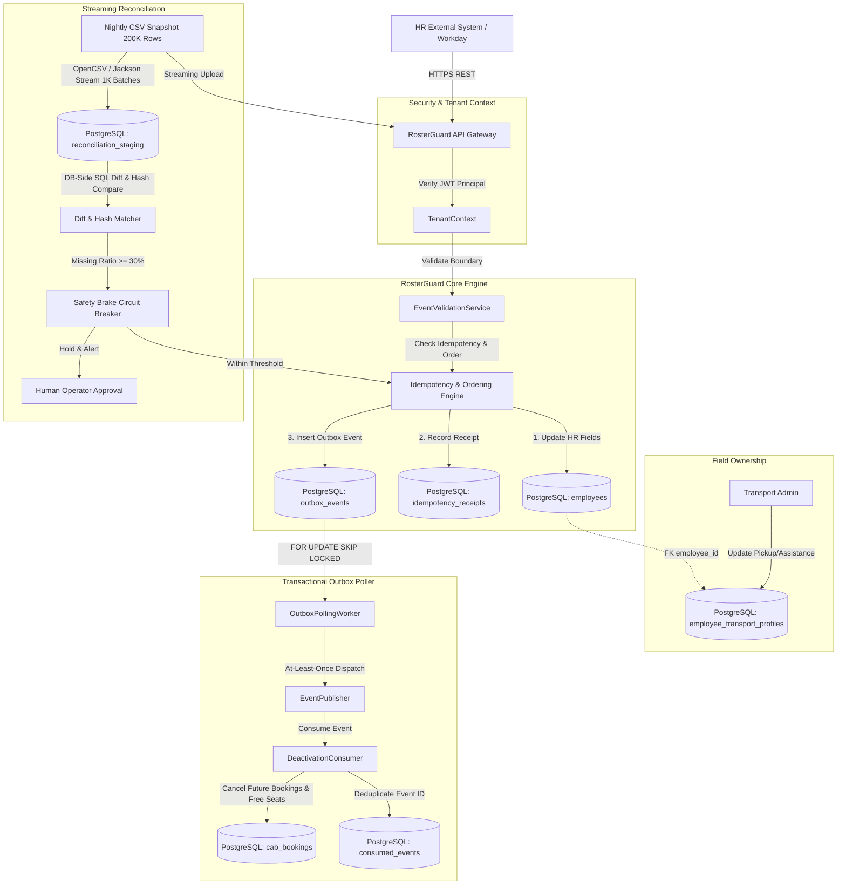
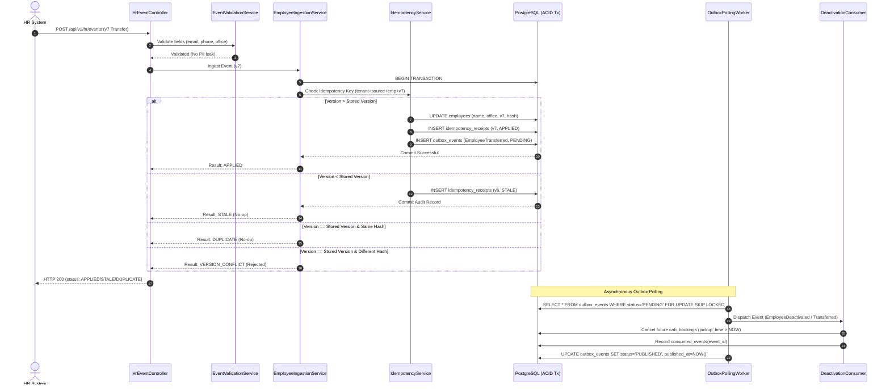
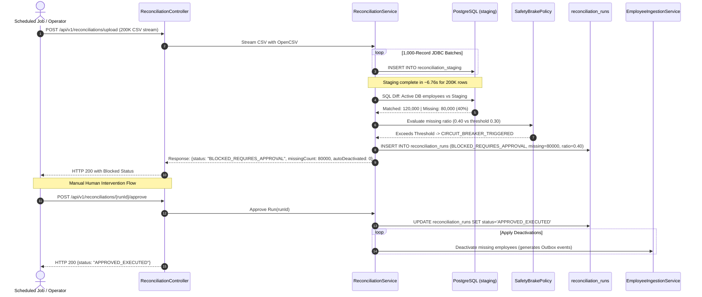

# RosterGuard — System Design & Architecture Specification

## 1. System Overview
**RosterGuard** is an idempotent, out-of-order, self-healing HR synchronization engine designed to bridge corporate HR systems and the MoveInSync employee transport fleet.

### Key Architectural Pillars
- **Strict Idempotency & Per-Employee Monotonic Ordering**: Guaranteed via composite keys and canonical SHA-256 payload hashing.
- **Physical Field Ownership**: Schema-level separation prevents HR updates from corrupting transport preferences.
- **Transactional Outbox with Lease Recovery**: Single-transaction database changes + durable outbox events with `FOR UPDATE SKIP LOCKED`.
- **Streaming Nightly Reconciliation with Safety Brake**: Bounded-memory CSV diff of 200,000 employees with configurable circuit breaker preventing catastrophic mass deactivations.
- **Tenant Isolation & RBAC**: Tenant context enforced from JWT authentication token.

---

## 2. Architecture Diagram



---

## 3. Event Processing Sequence Diagram



---

## 4. Database Consistency Decisions
1. **Isolation Level**: Read Committed with explicit pessimistic row locks (`SELECT ... FOR UPDATE`) during concurrent employee mutations to guarantee zero lost updates or version rollbacks.
2. **Single Transaction Boundary**: Employee update, idempotency receipt, and outbox event are committed atomically in one database transaction.
3. **Pessimistic Skip-Locked Work Queues**: Outbox worker polls using `FOR UPDATE SKIP LOCKED`, preventing database worker contention and deadlock states.

---

## 5. Failure Modes & Recovery Matrix

| Failure Mode | Root Cause / Trigger | User / Caller Experience | System Self-Healing & Recovery |
|---|---|---|---|
| **Out-of-Order Delivery** | Network jitter; v7 arrives before v6. | Caller receives `STALE` for v6. v7 state remains active. | Version comparison rejects v6; audit receipt stored in `idempotency_receipts`. |
| **Duplicate Events** | Source retry after timeout. | Caller receives `DUPLICATE` (HTTP 200). | Zero write to `employees`, idempotency key returns cached receipt. |
| **Version Payload Conflict** | Source bug sends two different payloads for same version. | Caller receives `VERSION_CONFLICT` (HTTP 409). | Transaction rolled back; recorded in security/audit log. |
| **Crash Before Outbox Dispatch** | JVM kills worker between DB commit and publication. | HR caller already received success (HTTP 200). | Next polling worker lease claims pending outbox row and publishes it. At-least-once guarantee. |
| **Truncated Nightly File** | Network drop cuts 200K CSV to 120K rows. | Reconciliation marked `BLOCKED_REQUIRES_APPROVAL`. | Safety brake aborts mass deactivations; operator reviews diff and approves or rejects run. |
| **Transport Preference Collision** | HR event attempts to update pickup point. | HR event applied; pickup point unchanged. | HR ingestion writes exclusively to `employees`; transport table remains untouched. |
| **Cross-Tenant Breach** | Caller supplies Tenant A token with Tenant B employeeId. | HTTP 404 / 403 Forbidden without leaking existence. | Queries enforce `WHERE tenant_id = :authenticatedTenantId`. |

---

## 6. Snapshot Reconciliation & Safety Brake Flow



---

## 7. Outbox Architecture & Lifecycle

The transactional outbox guarantees reliable event delivery to downstream consumers without requiring distributed two-phase commit (2PC).

### Outbox State Machine
```
[PENDING] ---------> [PROCESSING] ---------> [PUBLISHED]
   ^                      |
   |                      v (Worker Crash / Lease Timeout)
   +------------------ [RETRY]
                          | (Max Retries Exceeded)
                          v
                       [FAILED]
```

1. **Atomic Insertion**: When an employee event or deactivation occurs, the outbox record is inserted with status `PENDING` in the same database transaction.
2. **Leased Polling (`FOR UPDATE SKIP LOCKED`)**:
   ```sql
   SELECT * FROM outbox_events
   WHERE status = 'PENDING'
      OR (status = 'PROCESSING' AND lease_expires_at < NOW())
   ORDER BY created_at ASC
   LIMIT 50
   FOR UPDATE SKIP LOCKED;
   ```
3. **Lease Renewal & Crash Recovery**: Workers set `status = 'PROCESSING'` and `lease_expires_at = NOW() + 30s`. If a worker dies mid-flight, another worker claims the expired lease when `lease_expires_at < NOW()`.
4. **Consumer Deduplication**: The downstream consumer writes `(consumer_name, event_id)` into `consumed_events` within the consumer's local transaction. Replayed deliveries are skipped cleanly.

---

## 8. Architectural Trade-offs & Decisions

| Decision Area | Chosen Approach | Alternative Considered | Trade-off Justification |
|---|---|---|---|
| **Event Transport** | **PostgreSQL Transactional Outbox** | External Kafka / Redpanda Cluster | **Simplicity & Zero Dual-Write Hazard**: Avoids distributed 2PC or dual-write inconsistencies between database and external broker. PostgreSQL `FOR UPDATE SKIP LOCKED` achieves thousands of events/sec natively. Kafka was deferred to keep infrastructure self-contained and operationally robust. |
| **Field Ownership** | **Physical Schema Separation** (`employees` vs `employee_transport_profiles`) | Column-level permissions / Single Wide Table | **Defensive Architecture**: Placing transport fields in a separate table guarantees at the database schema level that HR ingestion SQL statements cannot overwrite transport attributes, even if application-level code bugs occur. |
| **CSV Snapshot Ingestion** | **OpenCSV Streaming + JDBC Batch Staging** | Full In-Memory Processing / Reactive Streams | **Predictable Bounded Memory**: Ingesting 200,000 rows in 1,000-record chunks consumes only ~227 MB heap delta, avoiding `OutOfMemoryError` on constrained JVMs while achieving ~29,603 rows/sec. |
| **Safety Circuit Breaker** | **Persistent Database State** (`reconciliation_runs`) | In-Memory Flag / Redis Lock | **Auditability & Survivability**: Storing run status and approval state in PostgreSQL ensures circuit breaker states survive application restarts and multi-node deployments with full regulatory audit trails. |
| **Concurrency Control** | **Row-Level Pessimistic Locking** (`SELECT FOR UPDATE`) | Optimistic Locking (`@Version`) | **Guaranteed Monotonic Ordering**: High-frequency out-of-order updates for the same employee serialize safely on the row lock rather than throwing optimistic lock retry exceptions under concurrent load. |
