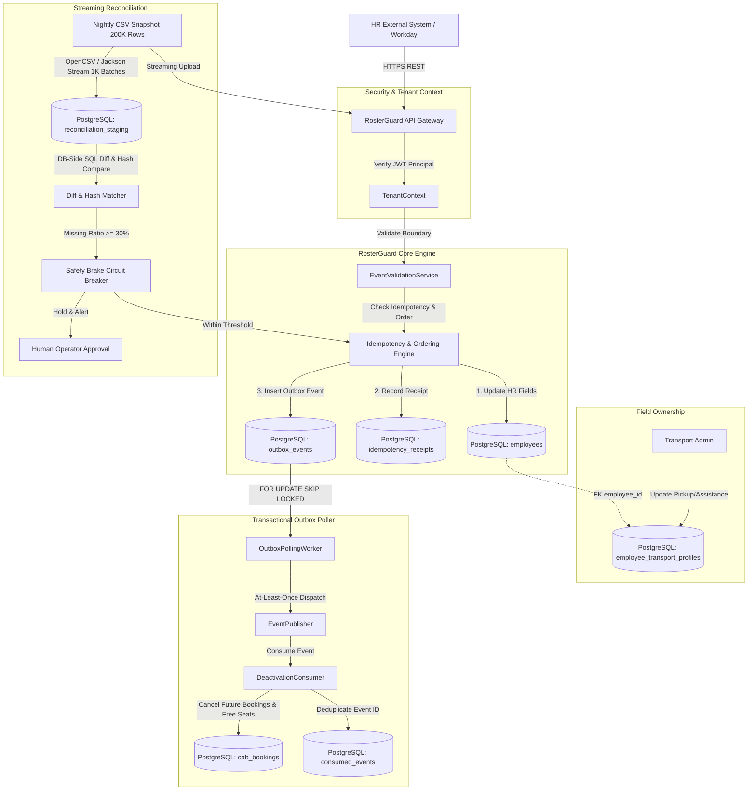
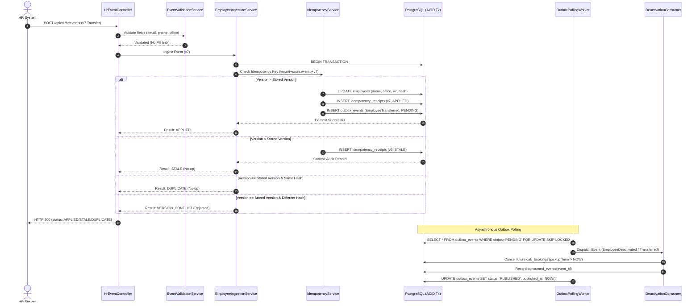

# RosterGuard — System Design & Architecture Specification

## 1. System Overview
**RosterGuard** is an idempotent, out-of-order, self-healing HR synchronization engine designed to bridge corporate HR systems and the MoveInSync employee transport fleet.

### Key Architectural Pillars
- **Strict Idempotency & Per-Employee Monotonic Ordering**: Guaranteed via composite keys and canonical SHA-256 payload hashing.
- **Physical Field Ownership**: Schema-level separation prevents HR updates from corrupting transport preferences.
- **Transactional Outbox with Lease Recovery**: Single-transaction database changes + durable outbox events with `FOR UPDATE SKIP LOCKED`.
- **Streaming Nightly Reconciliation with Safety Brake**: Bounded-memory CSV diff of 200,000 employees with configurable circuit breaker preventing catastrophic mass deactivations.
- **Tenant Isolation & RBAC**: Tenant context enforced from JWT authentication token.

---

## 2. Architecture Diagram

---

## 3. Event Processing Sequence Diagram

---

## 4. Database Consistency Decisions
1. **Isolation Level**: Read Committed with explicit pessimistic row locks (`SELECT ... FOR UPDATE`) during concurrent employee mutations to guarantee zero lost updates or version rollbacks.
2. **Single Transaction Boundary**: Employee update, idempotency receipt, and outbox event are committed atomically in one database transaction.
3. **Pessimistic Skip-Locked Work Queues**: Outbox worker polls using `FOR UPDATE SKIP LOCKED`, preventing database worker contention and deadlock states.

---

## 5. Failure Modes & Recovery Matrix

| Failure Mode | Root Cause / Trigger | User / Caller Experience | System Self-Healing & Recovery |
|---|---|---|---|
| **Out-of-Order Delivery** | Network jitter; v7 arrives before v6. | Caller receives `STALE` for v6. v7 state remains active. | Version comparison rejects v6; audit receipt stored in `idempotency_receipts`. |
| **Duplicate Events** | Source retry after timeout. | Caller receives `DUPLICATE` (HTTP 200). | Zero write to `employees`, idempotency key returns cached receipt. |
| **Version Payload Conflict** | Source bug sends two different payloads for same version. | Caller receives `VERSION_CONFLICT` (HTTP 409). | Transaction rolled back; recorded in security/audit log. |
| **Crash Before Outbox Dispatch** | JVM kills worker between DB commit and publication. | HR caller already received success (HTTP 200). | Next polling worker lease claims pending outbox row and publishes it. At-least-once guarantee. |
| **Truncated Nightly File** | Network drop cuts 200K CSV to 120K rows. | Reconciliation marked `BLOCKED_REQUIRES_APPROVAL`. | Safety brake aborts mass deactivations; operator reviews diff and approves or rejects run. |
| **Transport Preference Collision** | HR event attempts to update pickup point. | HR event applied; pickup point unchanged. | HR ingestion writes exclusively to `employees`; transport table remains untouched. |
| **Cross-Tenant Breach** | Caller supplies Tenant A token with Tenant B employeeId. | HTTP 404 / 403 Forbidden without leaking existence. | Queries enforce `WHERE tenant_id = :authenticatedTenantId`. |
