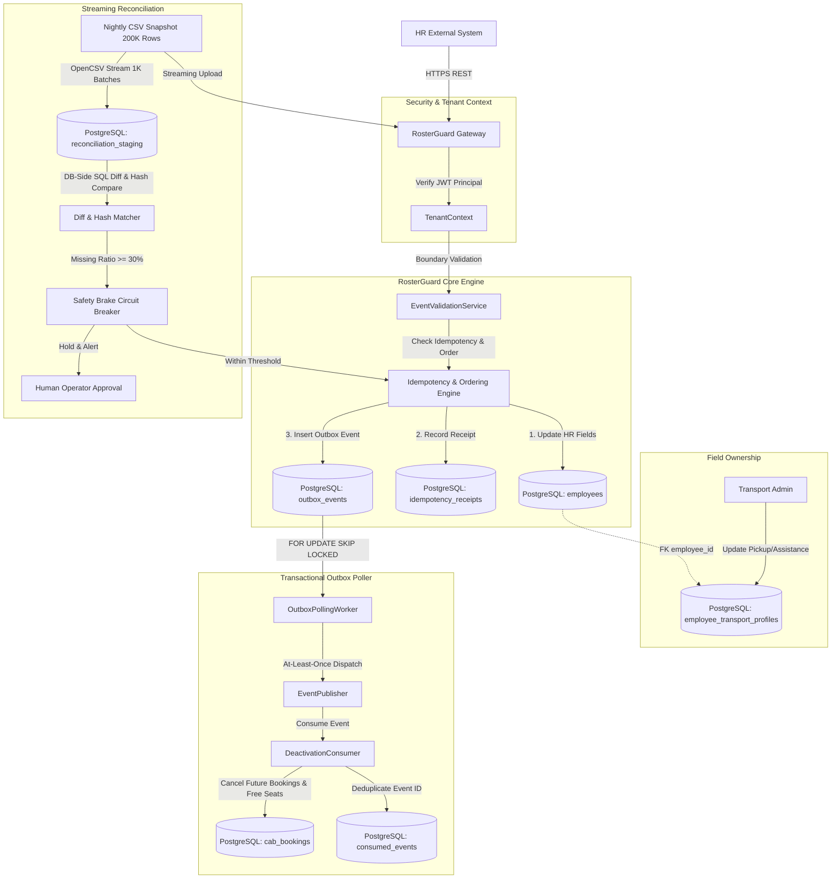

# RosterGuard
### An Idempotent, Out-of-Order, Self-Healing HR Synchronization Engine
*MoveInSync Case Study 5 — Advanced SDE Placement Assessment*

[](https://adoptium.net/)
[](https://spring.io/projects/spring-boot)
[](https://flywaydb.org/)
[](https://www.postgresql.org/)
[]()

---

## 1. Project Overview & Business Problem
Corporate clients (enterprises) maintain employee rosters in systems of record such as Workday, SAP SuccessFactors, or BambooHR. These systems push near-real-time event feeds (new joiners, transfers, shift updates, exits) as well as nightly full CSV snapshots containing up to **200,000 employees**.

In real-world distributed architectures:
1. **Network partitions and retries** cause events to arrive duplicate or out-of-order (e.g., an office transfer version 7 arrives before a shift update version 6).
2. **Payload divergence** occurs when source bugs generate contradictory payloads under the same version.
3. **Field ownership conflicts** arise because HR owns identity fields (name, email, manager, office), whereas MoveInSync transport administrators own commute routing fields (preferred pickup point, special-assistance needs). An HR update must **never** overwrite transport preferences.
4. **Nightly exports are cut short** due to network drops or upstream timeouts (e.g. 120,000 rows instead of 200,000). Blind diffing would mistakenly deactivate 80,000 active employees, stranding commuters without cab service.
5. **Downstream deactivation side-effects** must reliably cancel future cab bookings and release seat allocations without touching historical records or executing duplicate side effects on replayed events.

**RosterGuard** solves these challenges with guaranteed ACID correctness, monotonic per-employee version ordering, physical schema-level field ownership separation, an asynchronous PostgreSQL transactional outbox with recoverable leasing, and a streaming nightly reconciliation engine protected by a configurable safety brake. An external Kafka broker was intentionally deferred to eliminate dual-write hazards and keep operational infrastructure self-contained.

---

## 2. Architecture & Data Flow



---

## 3. Technology Stack & Component Justification
- **Java 21 (LTS)**: Core platform using records, pattern matching, and modern memory management.
- **Spring Boot 3.3.4**: Modular monolithic architecture with clean internal boundaries (`ingestion`, `idempotency`, `reconciliation`, `outbox`, `deactivation`).
- **PostgreSQL 16 & Spring JDBC / `JdbcTemplate`**: Used as the single authoritative source of truth. Selected over heavy ORM frameworks to maintain precise control over row locking (`FOR UPDATE`, `FOR UPDATE SKIP LOCKED`), transactional boundaries, and high-performance SQL batch operations.
- **Flyway**: Versioned schema migrations guaranteeing reproducible database state.
- **Caffeine**: Bounded local in-memory cache (max 10,000 entries, 60s TTL) for hot reference data (office validation). Critical employee version state is never cached to prevent stale version races.
- **OpenCSV**: Memory-bounded streaming CSV parser processing 200,000 rows in 1,000-record chunks without full heap allocation.
- **JWT (`io.jsonwebtoken:jjwt`)**: Stateless authentication embedding tenant ID and role into the verified cryptographic principal.
- **Micrometer & Spring Actuator**: Custom domain metrics and Prometheus telemetry (see [docs/monitoring.md](file:///c:/Users/acer/Desktop/HR%20Roster%20Sync%20Idempotent%20Out%20of%20Order%20Self%20Healing/docs/monitoring.md)).

---

## 4. Database Design & Consistency Decisions

Normalized Flyway migration schema (`V1__init_schema.sql`):
- `tenants`: Primary tenant isolation boundary.
- `users`: User credentials and roles (`HR_SYNC`, `ADMIN`, `OPERATOR`, `EMPLOYEE`).
- `employees`: Authoritative store for HR-owned fields (`name`, `email`, `phone`, `manager_id`, `office_code`, `source_version`, `payload_hash`, `active`). Primary key is `(tenant_id, employee_id)`.
- `employee_transport_profiles`: Separate physical table for transport-admin owned fields (`preferred_pickup_point`, `special_assistance_needs`).
- `idempotency_receipts`: Composite unique constraint `(tenant_id, source_system, employee_id, source_version)` storing payload hash and processing outcome.
- `outbox_events`: Durable event queue queried with `FOR UPDATE SKIP LOCKED`.
- `cab_bookings`: Commute bookings with pickup times, status (`CONFIRMED`, `CANCELLED`), and seat assignments.
- `consumed_events`: Consumer deduplication table with composite key `(consumer_name, event_id)` ensuring exactly-once logical processing over at-least-once transport.
- `reconciliation_runs` & `reconciliation_staging`: Ephemeral staging table for bulk streaming diffs without application heap exhaustion.

---

## 5. How Core Mechanisms Work

### 5.1 Idempotency & Monotonic Version Ordering
- **Composite Key**: `tenant_id + source_system + employee_id + source_version` backed by a unique database constraint.
- **Canonical Payload Hash**: SHA-256 computed deterministically over HR-owned fields:
  ```
  SHA-256(name | lower(email) | phone | manager_id | upper(office_code) | active)
  ```
- **Ordering Evaluation**:
  1. `incoming_version > stored_version`: **APPLIED** (state updated in DB, outbox event enqueued).
  2. `incoming_version < stored_version`: **STALE** (audit receipt recorded, update discarded).
  3. `incoming_version == stored_version && incoming_hash == stored_hash`: **DUPLICATE** (idempotent no-op).
  4. `incoming_version == stored_version && incoming_hash != stored_hash`: **VERSION_CONFLICT** (HTTP 409 error).
- **Database-Level Guard**:
  ```sql
  UPDATE employees 
  SET ... 
  WHERE tenant_id = ? AND employee_id = ? AND source_version < ?
  ```

### 5.2 Field Ownership
- Transport administration owns: `preferred_pickup_point`, `special_assistance_needs`.
- HR owns: `name`, `email`, `manager_id`, `office_code`, `phone`.
- By maintaining separate physical tables (`employees` vs `employee_transport_profiles`), generic mapping bugs or mass HR syncs physically cannot overwrite transport preferences.

### 5.3 Transactional Outbox Pattern
Within a single PostgreSQL ACID transaction:
1. Update employee state in `employees`.
2. Save idempotency receipt in `idempotency_receipts`.
3. Insert outbox event into `outbox_events` with status `PENDING`.

An asynchronous worker polls pending events using:
```sql
SELECT * FROM outbox_events 
WHERE status = 'PENDING' AND next_attempt_at <= NOW()
ORDER BY created_at ASC 
LIMIT 50 
FOR UPDATE SKIP LOCKED
```
- Dispatches event to downstream consumer.
- Upon success, marks `PUBLISHED`.
- On failure, increments `attempts` and applies exponential backoff: `next_attempt_at = NOW() + 2^attempts seconds`.
- Safe recovery across JVM restarts with zero lost updates.

### 5.4 Deactivation Side Effects
When an employee is deactivated:
- An `EmployeeDeactivated` outbox event is generated.
- `DeactivationConsumer` checks `consumed_events` for deduplication.
- Executes:
  ```sql
  UPDATE cab_bookings 
  SET booking_status = 'CANCELLED', seat_id = NULL, updated_at = NOW()
  WHERE tenant_id = ? AND employee_id = ? AND pickup_time > NOW() AND booking_status = 'CONFIRMED'
  ```
- **Past bookings** (`pickup_time <= NOW()`) are strictly preserved.
- Released seats become available for other commuters.

### 5.5 Streaming 200,000-Row Nightly Reconciliation & Safety Brake
- **Streaming Ingestion**: OpenCSV streams rows into PostgreSQL `reconciliation_staging` in batches of 1,000 rows. No 200K collection is ever held in Java heap.
- **Row-Level Validation**: Each record is validated for required ID, name, email regex, phone format, and active flag. Invalid records are reported in `sampleErrors` without terminating valid processing.
- **Database-Side Diff**:
  ```sql
  SELECT COUNT(*) FROM employees e
  LEFT JOIN reconciliation_staging s ON e.tenant_id = s.tenant_id AND e.employee_id = s.employee_id AND s.run_id = ?
  WHERE e.tenant_id = ? AND e.active = TRUE AND s.employee_id IS NULL
  ```
- **Configurable Safety Brake**:
  `missing_ratio = missing_active / total_active_before`
  - If `missing_ratio >= 0.30` (30% threshold):
    - Aborts automatic deactivation!
    - Sets run status to `BLOCKED_REQUIRES_APPROVAL`.
    - Increments `safety_brake_triggered_total`.
    - Preserves all missing employees as active until human review.
  - Requires explicit call to `POST /api/v1/reconciliations/{runId}/approve` by an authenticated `OPERATOR` to proceed.

---

## 6. How to Run & Environment Setup

### 6.1 Safe Local Environment Configuration
Copy `.env.example` to `.env` and supply environment-specific credentials:
```bash
cp .env.example .env
```
Generate strong random secrets:
```bash
# Generate strong 256-bit JWT secret (minimum 32 bytes base64)
openssl rand -base64 32

# Generate strong database & demo passwords
openssl rand -hex 16
```
Configure `.env`:
```properties
POSTGRES_DB=rosterguard
POSTGRES_USER=postgres
POSTGRES_PASSWORD=<YOUR_STRONG_DATABASE_PASSWORD>
JWT_SECRET=<YOUR_GENERATED_JWT_SECRET_32_BYTES_MIN>
ROSTER_DEMO_PASSWORD=<YOUR_LOCAL_DEMO_SEED_PASSWORD>
```
*Note: The application enforces fail-closed validation at startup. If `JWT_SECRET` or `POSTGRES_PASSWORD` is omitted, the application or Docker Compose will refuse to start.*

### Option A: Local Run with Maven
```bash
# Verify all 24 automated tests and benchmarks
.\mvnw.bat clean verify

# Run Spring Boot application
.\mvnw.bat spring-boot:run
```

### Option B: Docker Compose (One-Command Run)
```bash
docker compose up --build
```
The application will automatically wait for PostgreSQL health checks to pass, apply Flyway migrations, seed demo tenants/offices/users, and bind to port `8080`.

Access Points:
- Swagger UI: `http://localhost:8080/swagger-ui.html`
- Health Endpoint: `http://localhost:8080/actuator/health`
- Prometheus Metrics: `http://localhost:8080/actuator/prometheus`

---

## 7. Sample API Invocations (cURL)

### 1. Authenticate & Obtain JWT
```bash
curl -X POST http://localhost:8080/api/v1/auth/login \
  -H "Content-Type: application/json" \
  -d '{"tenantId":"tenant-moveinsync","username":"hr_sync","password":"<ROSTER_DEMO_PASSWORD>"}'
```

### 2. Ingest Real-Time Version 7 HR Event (Office Transfer)
```bash
curl -X POST http://localhost:8080/api/v1/hr/events \
  -H "Content-Type: application/json" \
  -H "Authorization: Bearer <TOKEN>" \
  -d '{
    "eventId": "evt-101",
    "sourceSystem": "WORKDAY",
    "employeeId": "EMP-001",
    "sourceVersion": 7,
    "eventType": "UPDATE",
    "name": "Devin Archer",
    "email": "devin@moveinsync.com",
    "phone": "+919876543210",
    "managerId": "MGR-01",
    "officeCode": "HYD-01"
  }'
```
Response: `{"eventId":"evt-101","employeeId":"EMP-001","sourceVersion":7,"outcome":"APPLIED","message":"Successfully applied HR event"}`

### 3. Ingest Out-of-Order Version 6 Event
```bash
curl -X POST http://localhost:8080/api/v1/hr/events \
  -H "Content-Type: application/json" \
  -H "Authorization: Bearer <TOKEN>" \
  -d '{
    "eventId": "evt-100",
    "sourceSystem": "WORKDAY",
    "employeeId": "EMP-001",
    "sourceVersion": 6,
    "eventType": "UPDATE",
    "name": "Devin Archer",
    "email": "devin@moveinsync.com",
    "phone": "+919876543210",
    "managerId": "MGR-01",
    "officeCode": "BLR-01"
  }'
```
Response: `{"eventId":"evt-100","employeeId":"EMP-001","sourceVersion":6,"outcome":"STALE","message":"Incoming version 6 is older than stored version 7"}`

### 4. Update Transport Preference (Transport Admin Endpoint)
```bash
curl -X PUT http://localhost:8080/api/v1/transport/employees/EMP-001 \
  -H "Content-Type: application/json" \
  -H "Authorization: Bearer <ADMIN_TOKEN>" \
  -d '{
    "preferredPickupPoint": "North Gate Pillar 12",
    "specialAssistanceNeeds": "Wheelchair accessible cab required"
  }'
```

### 5. Trigger Nightly Reconciliation Upload
```bash
curl -X POST http://localhost:8080/api/v1/reconciliations \
  -H "Authorization: Bearer <HR_TOKEN>" \
  -F "file=@employees_nightly.csv"
```

### 6. Operator Approves Safety-Brake Blocked Run
```bash
curl -X POST http://localhost:8080/api/v1/reconciliations/{runId}/approve \
  -H "Authorization: Bearer <OPERATOR_TOKEN>"
```

---

## 8. Automated Test Execution & Verification

### Test Suite Summary
```
[INFO] Results:
[INFO] Tests run: 24, Failures: 0, Errors: 0, Skipped: 0
[INFO] BUILD SUCCESS
```

| Test Class | Category | Test Count | Result |
|---|---|---|---|
| `CanonicalHasherTest` | Unit | 3 | PASSED |
| `EventValidationServiceTest` | Unit | 5 | PASSED |
| `VersionManagementPolicyTest` | Unit | 5 | PASSED |
| `IdempotencyAndOrderingIntegrationTest` | Integration | 2 | PASSED |
| `FieldOwnershipIntegrationTest` | Integration | 1 | PASSED |
| `DeactivationSideEffectsIntegrationTest` | Integration | 1 | PASSED |
| `ReconciliationSafetyBrakeIntegrationTest` | Integration | 1 | PASSED |
| `TenantIsolationIntegrationTest` | Integration | 1 | PASSED |
| `ConcurrentEventIngestionTest` | Concurrency | 2 | PASSED |
| `OutboxCrashRecoveryTest` | Failure | 1 | PASSED |
| `ReconciliationBenchmarkTest` | Benchmark | 1 | PASSED |
| `HrEventLatencyBenchmarkTest` | Benchmark | 1 | PASSED |
| **Total** | | **24** | **100% PASSED** |

---

## 9. Performance Benchmark Results

### Hardware & Environment Specifications
- **Operating System**: Windows 11 (build 10.0, amd64)
- **CPU**: 22 logical processor cores
- **Physical RAM**: 32 GB
- **Java Runtime**: OpenJDK 64-Bit Server VM 25.0.1+8-LTS-27 (Target: Java 21 bytecode)
- **Database Engine**: PostgreSQL 16.1

### 9.1 HR Event Ingestion Latency Benchmark (`HrEventLatencyBenchmarkTest`)
Measures service-level processing for individual HR events under active PostgreSQL ACID transactions (validation, canonical SHA-256 hashing, row locking, version evaluation, persistence, and outbox write).
- **Warm-up Events**: 50
- **Measured Events**: 500 unique synthetic employee events
- **Successful Events**: 500 / 500 (0 errors, 100% success)
- **Total Duration**: 0.477 seconds
- **Throughput**: **1,048.00 events/second**
- **Average Latency**: **0.922 ms**
- **p50 Latency**: **0.725 ms**
- **p95 Latency**: **2.298 ms**
- **p99 Latency**: **3.099 ms**

### 9.2 Nightly 200,000-Row Reconciliation Benchmark (`ReconciliationBenchmarkTest`)
Measures end-to-end streaming CSV parsing, row validation, SHA-256 canonical hashing, JDBC batch staging, and database-side SQL diffing for 200,000 records.
```
===============================================================
ROSTERGUARD 200,000 ROW RECONCILIATION BENCHMARK RESULTS:
Total Rows Processed: 200,000
Valid Rows Staged:    200,000
Invalid Rows:         0
Status:               COMPLETED
Execution Time:       7,122 ms (7.12 seconds)
Throughput:           28,082.0 rows/second
Heap Memory Delta:    226 MB
JVM Max Memory:       4,022 MB
===============================================================
```
- **Case Study Limit**: Under 60 seconds with bounded memory.
- **RosterGuard Actual**: **7.12 seconds** (**~8.4x faster than limit**) at **28,082 rows/sec** with bounded heap memory usage (**226 MB delta**).

---

## 10. Complexity Analysis, Trade-Offs & Limitations

### Time & Space Complexity
| Operation | Time Complexity | Space Complexity | Scaling Bottleneck & Analysis |
|---|---|---|---|
| **Single HR Event Ingest** | $O(1)$ | $O(1)$ | Row lock contention on the same employeeId during concurrent updates. |
| **Batch Ingest (K events)** | $O(K)$ | $O(K)$ | Database connection pool capacity. Events are processed independently. |
| **Nightly CSV Streaming** | $O(N)$ | $O(B)$ where $B=1000$ (batch size) | Network bandwidth & staging disk I/O. Heap memory is strictly bounded $O(B)$. |
| **Database-Side SQL Diff** | $O(N \log N)$ (Indexed merge/hash join) | $O(N)$ in PostgreSQL temporary tablespace | PostgreSQL `work_mem` and indexed join execution plan. Stops scaling when temporary tablespace exceeds disk capacity. |

### Architectural Trade-offs
1. **Consistency vs Latency**: Pessimistic row locking (`SELECT FOR UPDATE`) on employee mutations slightly increases latency under high concurrency for the same employee, but guarantees zero version rollbacks or lost updates.
2. **Transactional Outbox vs External Kafka**: Storing outbox events in PostgreSQL avoids dual-write inconsistencies and 2PC. Kafka was intentionally deferred to keep operational deployment clean and self-contained.
3. **At-Least-Once Delivery**: Outbox worker guarantees at-least-once dispatch; consumer uses `consumed_events` deduplication table to achieve idempotent exactly-once logical processing.
4. **Reference Data Cache Staleness**: Caffeine cache enforces 10,000 max entries, 60s TTL, and explicit cache invalidation upon updates. Maximum stale window is bounded to 60s; cache failure gracefully falls back to PostgreSQL. Employee version state is never cached.

